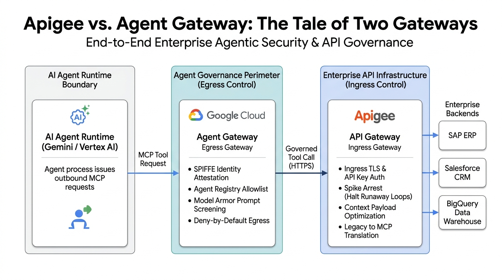

# Day 20: Apigee vs. Agent Gateway (The Tale of Two Gateways)

**Advent of Agents — Season 3 (October 2026)**  
**Authors:** Christopher Duncan & Elliott Abraham  
**Tags:** `Agent Gateway`, `Apigee`, `MCP`, `Security`, `API Management`  
**Video Demo:** *[5-minute demo video recording dropping tomorrow morning]*

---

### The Question Every Enterprise Architect Asks

When teams start building production AI agents on Google Cloud, the first question from platform and security teams is almost always:

> *"We already run Apigee across our entire enterprise. Why do we need Agent Gateway? Aren't they doing the same thing?"*

Here is the quick answer: **they protect completely different traffic directions.**

* **Apigee handles Ingress (Inbound / North-South):** It guards your internal databases, ERPs, and microservices against callers. It verifies API keys, enforces rate limits, transforms legacy formats, and presents clean APIs.
* **Agent Gateway handles Egress (Outbound):** Autonomous agents do not just receive requests; they make unpredictable, non-deterministic outbound calls to external tools and APIs. Agent Gateway sits directly in front of the agent runtime (Vertex AI, Cloud Run, or GKE) to enforce deny-by-default egress, check SPIFFE agent identity, and scan payloads with Model Armor before an agent reaches out to the world.

If you only use Apigee, your agent's outbound calls are unmonitored and vulnerable to prompt injection or rogue egress. If you only use Agent Gateway, your internal backends are exposed to runaway agent loops and context bloat. 

Using both gives you full perimeter protection: Agent Gateway controls what the agent is allowed to call, and Apigee controls how enterprise tools and backends are consumed.

---

### For Existing Apigee Teams: How to Use This Repo

If you already use Apigee in your organization, you do not need to replace anything or write custom MCP servers from scratch. 

You can use the proxy bundle in this repo (`advent-day20-mcp-proxy.zip`) as a **starter kit**:
1. Import and deploy the proxy into your existing Apigee environment.
2. It translates standard Model Context Protocol JSON-RPC requests (`tools/list` and `tools/call`) into your backend API calls.
3. It uses Apigee's built-in **Spike Arrest** policy to act as a circuit breaker. If an agent gets stuck in a recursive loop or starts rapid-firing requests, Apigee immediately throttles it with `HTTP 429` before your SAP, Salesforce, or BigQuery systems feel the impact.

---

### Ingress vs. Egress at a Glance

| Architectural Layer | Apigee API Gateway | Google Cloud Agent Gateway |
| :--- | :--- | :--- |
| **Where it sits** | In front of enterprise backends and databases | Right at the agent runtime boundary (VPC egress) |
| **Traffic direction** | Ingress (calls coming into your services) | Egress (calls initiated by autonomous agents) |
| **Identity model** | API keys, OAuth 2.0, developer apps | Ephemeral cryptographic SPIFFE workload identity |
| **Security focus** | WAF, DDoS protection, schema validation | Model Armor (prompt injection and jailbreak screening) |
| **Rate protection** | Spike arrest and quotas (stops backend exhaustion) | Deny-by-default allowlists (stops unauthorized tool reach) |
| **Context efficiency** | Strips massive JSON/XML responses down to clean tool output | Passes clean, verified tool results back to the LLM |

---

### How the Request Flows



```
+-------------------------------------------------------------------------------+
|                       AUTONOMOUS AGENT RUNTIME BOUNDARY                       |
|                                                                               |
|  +--------------------+             +--------------------------------------+  |
|  |   Gemini Agent     |             |        AGENT GATEWAY (Egress)        |  |
|  | (Vertex / ADK)     |  MCP Call   |                                      |  |
|  |                    +------------>|  [1] Validate SPIFFE workload ID     |  |
|  | [SPIFFE ID]        |             |  [2] Check Agent Registry allowlist  |  |
|  +--------------------+             |  [3] Scan prompt with Model Armor    |  |
|                                     |  [4] Enforce deny-by-default rule    |  |
|                                     +-------------------+------------------+  |
+---------------------------------------------------------|---------------------+
                                                          | Allowed tool call
                                                          v (HTTPS / mTLS)
+-------------------------------------------------------------------------------+
|                         ENTERPRISE API INFRASTRUCTURE                         |
|                                                                               |
|  +-------------------------------------------------------------------------+  |
|  |                         APIGEE API GATEWAY                              |  |
|  |                                                                         |  |
|  |  [A] Ingress TLS termination                                            |  |
|  |  [B] Verify API Key & calling app entitlements                          |  |
|  |  [C] Spike Arrest: halt recursive agent loops (HTTP 429)                |  |
|  |  [D] ExtractVariables: strip heavy 50-field payloads to clean JSON      |  |
|  +-------------------------------------+-----------------------------------+  |
+----------------------------------------|--------------------------------------+
                                         | Clean tool invocation
                                         v
               +---------------------------------------------------+
               |  Enterprise Backends: SAP / Salesforce / BigQuery |
               +---------------------------------------------------+
```

---

### What Is in This Repo

* `advent-day20-mcp-proxy.zip`: Pre-built Apigee proxy bundle ready to import and deploy.
* `advent_day20_apiproxy/`: Unpacked XML proxy definition and policy files:
  * `SA-SpikeArrest.xml`: Throttles burst calls (set to 10 requests per minute for this kata).
  * `Extract-MCP-Method.xml`: Extracts the JSON-RPC method (`tools/list` vs. `tools/call`).
  * `AM-Return-Tools-List.xml`: Returns the MCP tool schema.
  * `AM-Execute-Customer-Lookup.xml`: Returns the customer account record.
  * `policies/optional_llm_policies/`: Ready-to-use policies for LLM Token Quotas, Response Caching, Context Trimming, and API Key verification.
* `demo_runner.py`: A simple test runner that verifies tool discovery, calls the tool, and triggers Spike Arrest with a burst test.
* `deploy_to_apigee.sh`: Bash script to deploy the proxy bundle using Apigee Management APIs.
* `.env.example`: Starter environment file for configuring your Apigee host and GCP project.

---

### Hands-On Kata: Running the Demo

#### 1. Setup your environment
Copy `.env.example` to `.env` (or set environment variables in your shell):

```bash
export APIGEE_HOST="<your-apigee-host-or-ip>"
# or
export APIGEE_MCP_URL="https://<your-apigee-host-or-ip>/v1/mcp"
```

#### 2. Test MCP Tool Discovery (`tools/list`)
Ask Apigee what tools are available over standard Model Context Protocol:

```bash
curl -X POST "${APIGEE_MCP_URL:-https://${APIGEE_HOST}/v1/mcp}" \
  -H "Content-Type: application/json" \
  -d '{"jsonrpc": "2.0", "id": 1, "method": "tools/list", "params": {}}'
```

Apigee responds with the tool schema:
```json
{
  "jsonrpc": "2.0",
  "id": 1,
  "result": {
    "tools": [
      {
        "name": "lookup_customer_account",
        "description": "Governed enterprise tool to fetch verified customer account data.",
        "inputSchema": {
          "type": "object",
          "properties": {"customer_id": {"type": "string"}},
          "required": ["customer_id"]
        }
      }
    ]
  }
}
```

#### 3. Test Tool Execution (`tools/call`)
Now invoke the tool through Apigee:

```bash
curl -X POST "${APIGEE_MCP_URL:-https://${APIGEE_HOST}/v1/mcp}" \
  -H "Content-Type: application/json" \
  -d '{
    "jsonrpc": "2.0",
    "id": 2,
    "method": "tools/call",
    "params": {
      "name": "lookup_customer_account",
      "arguments": {"customer_id": "CUST-9921"}
    }
  }'
```

Apigee returns the customer record:
```json
{
  "jsonrpc": "2.0",
  "id": 2,
  "result": {
    "content": [
      {
        "type": "text",
        "text": "{\"customer_id\": \"CUST-9921\", \"status\": \"ACTIVE\", \"tier\": \"PLATINUM\", \"verified_by\": \"APIGEE_ENTERPRISE_GATEWAY\"}"
      }
    ]
  }
}
```

#### 4. Test Runaway Loop Protection (Spike Arrest)
Run the Python test runner to verify everything end-to-end, including rapid successive requests:

```bash
python3 demo_runner.py
```

Because the proxy enforces a `10pm` Spike Arrest policy (1 request every 6 seconds), rapid burst calls immediately trigger `HTTP 429 Too Many Requests`:

```text
Request 1: HTTP 200
Request 2: HTTP 429 -> SpikeArrestViolation intercepted by Apigee!
Request 3: HTTP 429 -> SpikeArrestViolation intercepted by Apigee!
```

This prevents a looping or misconfigured AI agent from hammering your backend databases.

---

### Deploying the Proxy to Your Own GCP Project

If you want to deploy this proxy bundle directly to your own Apigee organization:

```bash
export PROJECT_ID="<your-gcp-project-id>"
export ENV_NAME="<your-apigee-env>"  # e.g., dev, eval, or prod

chmod +x deploy_to_apigee.sh
./deploy_to_apigee.sh
```

---

### Optional Starter Policies for LLM Governance

Inside `advent_day20_apiproxy/policies/optional_llm_policies/`, we have included 4 additional policies you can attach to your proxy flows as your architecture matures:

* **`LLM-Token-Quota.xml`:** Tracks token counts using Apigee's native `LLMTokenQuota` policy to enforce Tokens Per Minute (TPM) limits per agent.
* **`RC-Tool-Response-Cache.xml`:** Caches tool lookups at the Apigee edge so repetitive queries do not cost extra latency or backend calls.
* **`EV-Trim-Context-Payload.xml`:** Extracts only the necessary fields from noisy 50+ field enterprise responses before returning them to the LLM context window.
* **`VAK-Verify-API-Key.xml`:** Enforces standard API key authentication for client applications calling the tool.

---

### Wrap-Up

* Use **Agent Gateway** on outbound agent traffic to stop prompt injection, attest agent identity, and block unauthorized network egress.
* Use **Apigee** on inbound tool traffic to convert enterprise APIs into MCP tools, protect backends with spike arrest, and keep payloads lean.
* Put them together for a zero-trust, production-ready AI agent architecture.
