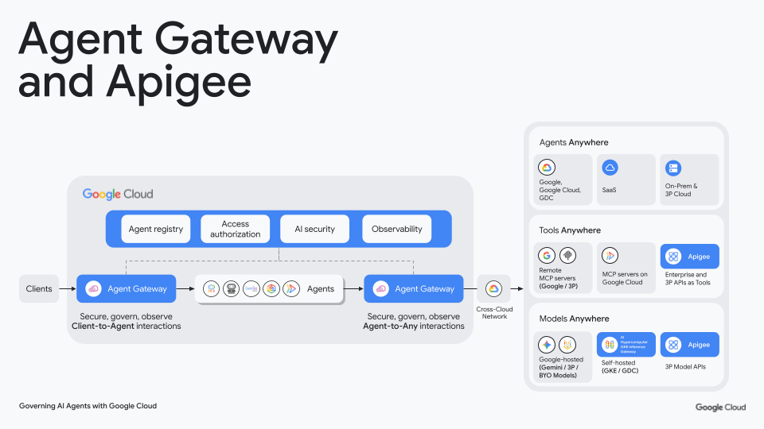

# Day 20: Apigee vs. Agent Gateway (The Tale of Two Gateways)

**Advent of Agents — Season 3 (October 2026)**  
**Authors:** Christopher Duncan & Elliott Abraham  
**Tags:** `Agent Gateway`, `Apigee`, `MCP`, `Security`, `API Management`  
**Video Demo:** *[5-minute video demo dropping tomorrow morning]*

---

### The Question Every Enterprise Team Asks

When teams start building production AI agents on Google Cloud, we almost always get asked:

> *"We already run Apigee across our whole company. Why do we need Agent Gateway? Aren't they doing the same thing?"*

Here's the deal: **they handle two completely different traffic patterns.**

* **Apigee is for Ingress (Inbound / North-South):** It guards your internal databases, ERPs, and microservices against incoming callers. It checks API keys, enforces rate limits, transforms legacy payloads, and keeps bad traffic off your servers.
* **Agent Gateway is for Egress (Outbound):** AI agents don't just sit there waiting for web traffic. They actively call external tools, third-party APIs, and MCP servers on their own. Agent Gateway sits right next to the agent runtime (Google Cloud Agent Platform, Cloud Run, GKE) to enforce a deny-by-default firewall on outbound tool calls, verify the agent's cryptographic SPIFFE identity, and run Model Armor on prompts before an agent reaches out to the world.

If you only run Apigee, your agent's outbound calls are flying blind with zero egress guardrails. If you only run Agent Gateway, your internal databases have no protection against runaway agent loops or context bloat. 

Using them together gives you end-to-end defense: Agent Gateway controls what the agent is allowed to call, and Apigee controls how enterprise tools and backends are consumed.

---

### Already using Apigee? Start here

If your company already standardizes on Apigee, you don't need to rebuild your backends or write custom MCP servers from scratch. 

You can take the proxy bundle in this repo (`advent-day20-mcp-proxy.zip`) and use it as a **starter kit**:
1. Drop the proxy bundle straight into your existing Apigee environment.
2. It translates standard Model Context Protocol JSON-RPC requests (`tools/list` and `tools/call`) directly into your backend APIs.
3. It puts Apigee's built-in **Spike Arrest** policy to work as a circuit breaker. If an agent hallucinates, loops recursively, or starts rapid-firing requests, Apigee cuts it off with an `HTTP 429` before your SAP, Salesforce, or BigQuery systems feel any pain.

---

### Ingress vs. Egress at a Glance

| Architectural Layer | Apigee API Gateway | Google Cloud Agent Gateway |
| :--- | :--- | :--- |
| **Where it sits** | In front of internal enterprise backends | Right at the agent runtime boundary (VPC egress) |
| **Traffic direction** | Ingress (traffic coming into your APIs) | Egress (calls initiated by your agents) |
| **Caller identity** | App API keys, OAuth 2.0, developer apps | Ephemeral cryptographic SPIFFE workload identity |
| **Security scanning** | WAF, DDoS mitigation, schema validation | Model Armor (prompt injection and jailbreak screening) |
| **Rate protection** | Spike arrest and quotas (stops backend meltdown) | Deny-by-default allowlists (stops rogue tool calls) |
| **Context efficiency** | Trims heavy JSON/XML down to clean tool responses | Passes filtered, verified tool context back to the model |

---

### Architecture Flow



1. **Client-to-Agent Ingress:** Incoming user requests hit the front-door Agent Gateway.
2. **Autonomous Agent Runtime:** Gemini agents running on Google Cloud Agent Platform (or Cloud Run / GKE) pick tools dynamically based on user prompts.
3. **Agent-to-Any Egress Boundary:** The egress Agent Gateway intercepts outbound MCP tool calls, validates the agent's SPIFFE identity, checks the Agent Registry allowlist, and runs Model Armor prompt screening.
4. **Enterprise Tool Ingress (Apigee):** Permitted calls cross the network into Apigee, which handles TLS, checks client API keys, enforces Spike Arrest to kill recursive loops, and mediates payloads to your backends (SAP, Salesforce, BigQuery).

---

### What's in This Repo

* `advent-day20-mcp-proxy.zip`: Pre-built Apigee starter bundle that exposes enterprise services as an MCP tool and includes Spike Arrest runaway loop protection.
* `assets/architecture_flow.png`: Official architecture diagram showing how Agent Gateway and Apigee fit together.
* `demo_runner.py`: Simple Python test runner to verify discovery (`tools/list`), tool calls (`tools/call`), and Spike Arrest (`429`).
* `.env.example`: Starter config for your Apigee host and project ID.

---

### Hands-On Kata: Running the Demo

#### 1. Setup your environment
Copy `.env.example` over to `.env` (or set environment variables in your terminal):

```bash
export APIGEE_HOST="<your-apigee-host-or-ip>"
# or
export APIGEE_MCP_URL="https://<your-apigee-host-or-ip>/v1/mcp"
```

#### 2. Test MCP Tool Discovery (`tools/list`)
Ask Apigee what tools are available over standard Model Context Protocol:

```bash
curl -X POST "${APIGEE_MCP_URL:-https://${APIGEE_HOST}/v1/mcp}" \
  -H "Content-Type: application/json" \
  -d '{"jsonrpc": "2.0", "id": 1, "method": "tools/list", "params": {}}'
```

Apigee returns the MCP tool schema:
```json
{
  "jsonrpc": "2.0",
  "id": 1,
  "result": {
    "tools": [
      {
        "name": "lookup_customer_account",
        "description": "Governed enterprise tool to fetch verified customer account data.",
        "inputSchema": {
          "type": "object",
          "properties": {"customer_id": {"type": "string"}},
          "required": ["customer_id"]
        }
      }
    ]
  }
}
```

#### 3. Test Tool Execution (`tools/call`)
Now call the tool through Apigee:

```bash
curl -X POST "${APIGEE_MCP_URL:-https://${APIGEE_HOST}/v1/mcp}" \
  -H "Content-Type: application/json" \
  -d '{
    "jsonrpc": "2.0",
    "id": 2,
    "method": "tools/call",
    "params": {
      "name": "lookup_customer_account",
      "arguments": {"customer_id": "CUST-9921"}
    }
  }'
```

Apigee sends back the customer record:
```json
{
  "jsonrpc": "2.0",
  "id": 2,
  "result": {
    "content": [
      {
        "type": "text",
        "text": "{\"customer_id\": \"CUST-9921\", \"status\": \"ACTIVE\", \"tier\": \"PLATINUM\", \"verified_by\": \"APIGEE_ENTERPRISE_GATEWAY\"}"
      }
    ]
  }
}
```

#### 4. Test Runaway Loop Protection (Spike Arrest)
Run the Python test runner to verify everything, including rapid burst calls:

```bash
python3 demo_runner.py
```

Since the proxy enforces a `10pm` Spike Arrest policy (1 request every 6 seconds), rapid burst calls immediately trigger `HTTP 429 Too Many Requests`:

```text
Request 1: HTTP 200
Request 2: HTTP 429 -> SpikeArrestViolation intercepted by Apigee!
Request 3: HTTP 429 -> SpikeArrestViolation intercepted by Apigee!
```

That's how you keep a looping or hallucinating agent from bringing down your backend databases.

---

### Deploying Both Gateways to Your Own GCP Project

If you want to spin up both gateways in your own Google Cloud project:

#### 1. Import and Deploy the Apigee MCP Proxy
Upload the bundle directly to your Apigee organization:

```bash
TOKEN=$(gcloud auth print-access-token)

# Import bundle
curl -X POST -H "Authorization: Bearer ${TOKEN}" -H "Content-Type: application/octet-stream" \
  --data-binary "@advent-day20-mcp-proxy.zip" \
  "https://apigee.googleapis.com/v1/organizations/${PROJECT_ID}/apis?action=import&name=advent-day20-mcp-proxy"

# Deploy revision 1 to your environment
curl -X POST -H "Authorization: Bearer ${TOKEN}" \
  "https://apigee.googleapis.com/v1/organizations/${PROJECT_ID}/environments/${ENV_NAME}/apis/advent-day20-mcp-proxy/revisions/1/deployments?override=true"
```

#### 2. Create the Agent Gateway Egress Boundary
Create your outbound gateway and register Apigee in Agent Registry:

```bash
# Create the Egress Agent Gateway
gcloud alpha network-services agent-gateways create advent-egress-gw \
    --project="${PROJECT_ID}" \
    --location="us-central1" \
    --type="AGENT_TO_ANYWHERE" \
    --protocol="MCP"

# Register Apigee as an approved tool in Agent Registry
gcloud alpha agent-registry services create apigee-enterprise-mcp \
    --project="${PROJECT_ID}" \
    --location="global" \
    --endpoint="https://${APIGEE_HOST}/v1/mcp"
```

---

### Bottom Line

* Put **Agent Gateway** on outbound agent traffic to stop prompt injection, verify agent identity, and block unauthorized network egress.
* Put **Apigee** on inbound tool traffic to expose enterprise APIs as MCP tools, protect backends with spike arrest, and keep payloads small.
* Run them together and you get zero-trust security across the whole agent lifecycle.
